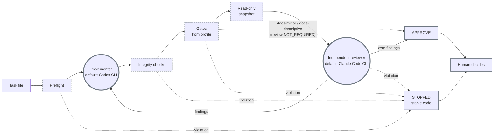

<p align="center">
  
</p>

<h1 align="center">Ringi Gate</h1>

<p align="center">
  A fail-closed pipeline for AI coding agents: one implementer, an
  independent read-only reviewer, deterministic gates, and a human who decides what gets
  published.
</p>

<p align="center">
  = 24">
  
  <a href="#license"></a>
  <a href="CONTRIBUTING.md"></a>
</p>

<p align="center">
  
</p>

<details>
<summary>How the demo above was captured</summary>

The image shows the real standard output of the CLI, shortened at the lines
marked `…`; no other line was changed. It was captured on a synthetic
repository in the system temporary directory, built from [examples/](examples/):

- the runner modules from `scripts/` copied into its `scripts/` directory,
  with [examples/project-profile.mjs](examples/project-profile.mjs) as
  `scripts/agent-review-profile.mjs`;
- [examples/task-add-health-endpoint.md](examples/task-add-health-endpoint.md)
  copied unchanged to `tasks/add-health-endpoint.md`;
- a small pnpm workspace (`@example/api`, `@example/web`) installed offline
  with pnpm 11.20.0 from the local Corepack cache, committed on the branch
  `feat/health-endpoint`;
- `git`, `pnpm` and Corepack were the real programs. `codex` and `claude`
  were stand-in scripts that only answer `--version`: a dry-run starts no
  agent, but its preflight checks both versions, so the plan shows
  `codex (stub for demo) 0.0.0`.

The exit code was `0` and nothing was written to standard error. The image
comes from an earlier version of the CLI, which printed the plan's
`sequence` and `mutations` values in Polish; the current CLI prints them in
the profile's `locale` (English by default). The capture script is not part
of this repository.

</details>

## Ringi in 60 seconds

**1. Describe your project in a profile.** The profile is a JavaScript
module that lists the only commands the runner may use as gates. Abridged
from [examples/project-profile.mjs](examples/project-profile.mjs):

```js
export const PROFILE = {
  title: 'EXAMPLE WORKFLOW',
  tempPrefix: 'example-review-',
  checks: {
    'pnpm lint': { program: 'pnpm', args: ['lint'], timeoutMs: 10 * 60_000 },
    'pnpm --filter @example/api run test:integration': {
      program: 'pnpm',
      args: ['--filter', '@example/api', 'run', 'test:integration'],
      timeoutMs: 30 * 60_000,
    },
    'git diff --check': { program: 'git', args: ['diff', '--check'], timeoutMs: 2 * 60_000 },
    // … 'pnpm test', 'pnpm docs:check'
  },
  checkSets: {
    base: ['pnpm lint', 'git diff --check'],
    docs: ['pnpm docs:check', 'git diff --check'],
  },
  requiredGateRules: [
    {
      check: 'pnpm --filter @example/api run test:integration',
      prefixes: ['packages/api/src/db/'],
      paths: ['packages/api/schema.sql'],
      code: 'API_INTEGRATION_GATE',
    },
  ],
  // … optional: taskClasses, docsCandidatePolicy, implementer, reviewer
};
```

**2. Write a task in Markdown.** Required sections, an optional class, and
the checks the task needs, each named exactly as in the profile. Abridged
from [examples/task-add-health-endpoint.md](examples/task-add-health-endpoint.md).
The headings are the canonical section names of the default task schema; the
Polish names (`Cel`, `Zakres`, `Wymagane kontrole`…) are accepted as aliases
and parse to the same result, see
[examples/validate-examples.test.mjs](examples/validate-examples.test.mjs):

```md
## Task class

implementation

## Goal

Expose a read-only health endpoint in the example API so that a load balancer
can check whether the service is up.

## Scope

- Add a GET route at /health in packages/api/src/routes/health.ts that
  returns status 200 and the JSON body {"status":"ok"}.

## Acceptance criteria

- GET /health returns 200 with {"status":"ok"} and no other fields.

## Required checks

- `pnpm test`
- `pnpm --filter @example/api run test:integration`

## Constraints

- Do not add or update dependencies.

## Deferred items

- Metrics endpoint.
```

**3. Check the plan, then run.** With the profile in `ringi.config.mjs` at
the root of the target repository (see
[Running the runner on a project](#running-the-runner-on-a-project)):

```sh
ringi run tasks/add-health-endpoint.md --dry-run
ringi run tasks/add-health-endpoint.md
```

The dry-run validates the profile, the repository and the task and prints
the plan shown in the demo: the profile's `base` checks followed by the
task's own checks, the review decision and the pinned pnpm version. The
second command runs the implementer, the gates and the independent review, and
ends with `APPROVE`, or `STOPPED` with a stable code, in a JSON report.

## How Ringi differs

A neutral comparison with two common ways of running coding agents. The
first two columns describe typical setups, not any specific product.

| | A prompt or skill for one agent | An autonomous orchestrator | Ringi |
| --- | --- | --- | --- |
| Who checks the work | Usually the same agent, by following its instructions | Often other agents, under the orchestrator's control | A separate reviewer on a read-only copy; the runner, not the reviewer's verdict, sets `APPROVE` |
| Tests and linters | Run by the agent, which reports the result | Varies; often run by agents | Run by the runner itself after the implementer, only as declared in the profile |
| Unexpected state | The agent decides how to continue | Often retried or worked around | The run stops with a stable code; nothing is repaired or reverted |
| Agents at a time | One | Many, often in parallel | One implementer per round; one agent process at a time |
| Git and publication | Whatever the agent is allowed to do | Often opens or merges pull requests | Never commits, pushes or merges; never sets `publicationApproved` to `true` |
| Configuration | Prose instructions | Workflow definitions or code | A data profile validated fail-closed; unknown keys are rejected |

## Why fail-closed

Agents are useful, but their reports are claims, not evidence. Ringi treats
every unexpected state it checks for as a reason to stop: an unknown check, a
moved branch, a staged file, a changed lockfile, a new secret-like string, a
gate that modified a checked file (tracked or untracked, non-ignored files
outside build and cache directories; see [SECURITY.md](SECURITY.md)). The run
ends with a stable code in a JSON report instead of a guess or an automatic
repair. Any review finding sends the work back to the implementer; after 3 rounds,
a disputed finding or a question for a human, the run stops.

| Ringi does | Ringi does not |
| --- | --- |
| Run one implementer agent per round in your working tree, with Git and package managers behind guard scripts | Commit, push, open pull requests or merge |
| Run only the gate commands declared in the project profile, itself, after the implementer | Execute text from a task as a shell command |
| Give the reviewer a read-only copy, the full diff and the runner's own gate report | Treat the implementer's self-report as proof |
| Require zero findings, at every severity, before `APPROVE` when independent review is required (every default task class except `docs-minor` and `docs-descriptive`, see below) | Auto-merge, or mark anything as approved for publication |
| Stop with a code and leave the changes for a human to inspect | Silently fix or revert a failure |
| Run locally, one agent process at a time | Run a fleet of agents in the cloud |

## How it works



The two agent roles are drawn as thick rings, like the two rings of the
mark; dashed boxes are steps the runner performs itself; the result always
goes to a human. The profile chooses the provider of each role; the
diagram shows the default profile setting (Codex CLI as the implementer,
Claude Code CLI as the reviewer).

Trust boundaries:

- **The implementer** works in the real working tree: with Codex CLI (the
  default) in the Codex sandbox with network access disabled; with Claude
  Code (experimental) with file tools confined to the repository and
  commands only in the Claude Code sandbox without network; see
  [docs/architecture.md](docs/architecture.md#claude-code-as-implementer).
  Its `git` is a guard that passes only an allowlist of
  read-only subcommand names (options are not filtered); its `pnpm` allows
  only the task's declared pnpm checks (and nested invocations declared for
  them in the profile); other package managers are blocked. The guards cover
  only commands resolved through `PATH`; see [SECURITY.md](SECURITY.md).
- **Runner** is the only component whose results count: it runs the gates,
  verifies that Git state, dependencies and checked files did not change
  where they must not, scans for secrets and writes the report.
- **Reviewer** gets a read-only copy with tools limited to `Read`, `Glob` and
  `Grep`. The runner, not the reviewer's verdict, sets `APPROVE`.
- **Exception:** for the task classes `docs-minor` and `docs-descriptive`
  (chosen in the task file) independent review is skipped and recorded as
  `NOT_REQUIRED`. `APPROVE` then means only that the profile's `docs` gates
  passed; the change may only touch `README.md` and Markdown files under
  `docs/`. Classes and this path rule are profile data with these defaults;
  a profile can skip review only for classes limited to the docs path rule
  (see [docs/profile.md](docs/profile.md#taskclasses)).
- **Human** reads the report. Run reports (`APPROVE` or `STOPPED`) carry
  `publicationApproved: false`; the runner never sets it to `true` (the CLI's
  last-resort error report omits the field; see
  [docs/good-first-issues.md](docs/good-first-issues.md)).

Details: [docs/architecture.md](docs/architecture.md).

## Quickstart (today)

What works today is the runner core, the `ringi` command that runs it on a
project (installed from npm or from a checkout), and the test suite. The
steps below set up a checkout of this repository.

Requirements:

- Node.js 24 or newer;
- Git 2.45 or newer (the committed-profile check sets `GIT_NO_LAZY_FETCH`,
  see [docs/cli.md](docs/cli.md#git-version));
- Corepack with pnpm 11.20.0 in its local cache, for the tests that run real
  pnpm (see [docs/testing.md](docs/testing.md)).

```sh
npm install
npm test
```

The runner has no runtime dependencies beyond Node.js built-ins.

### Running the runner on a project

From version 0.1.0 the runner is installed from npm (see
[Installation from npm](#installation-from-npm)); below, `ringi` stands for
that command. The alternative is a checkout: clone ringi-core and run its
entry point with Node.js from the root of the target repository, so
`ringi` stands for `node /path/to/ringi-core/bin/ringi.mjs` (see
[docs/cli.md](docs/cli.md)). Keep that checkout outside the target
repository and outside any directory the implementer can write to. The run
fingerprints the runner's own modules when it starts and stops with
`RUNNER_MODIFIED` if they change during the run, but a change made before
the run is not detected; `ringi doctor` warns (`runner-location`) when the
runner lies inside the repository.

```sh
ringi init       # creates ringi.config.mjs and tasks/example-task.md; never overwrites
git add ringi.config.mjs && git commit -m "Add ringi profile"   # init commits nothing
ringi doctor     # read-only checks of the repository and this machine
ringi run path/to/task.md --dry-run
ringi run path/to/task.md
```

`ringi init` infers the gates from the `check`, `lint` and `test` scripts of
`package.json` (plus `git diff --check`) and does not create `AGENTS.md` or
`CLAUDE.md`. `ringi doctor` reports `ok`, `warn` or `fail` for each
requirement, with a hint. A target repository needs:

- `package.json` with `packageManager` pinned to an exact pnpm version, that
  pnpm version in the local Corepack cache, and dependencies installed with
  pnpm;
- `AGENTS.md` and `CLAUDE.md` at the root;
- `ringi.config.mjs` at the root (the profile; `ringi init` writes a first
  one), committed together with the modules it imports;
- a working branch (not `main` or `master`) with nothing staged;
- `git` (2.45 or newer), `pnpm`, `corepack` and the implementer's CLI on
  `PATH`, plus the reviewer's CLI when the task requires independent review
  (with the default profile setting, `codex` and `claude`).

`ringi run` loads `ringi.config.mjs` once, before the first round, with a
SHA-256 fingerprint of it and of every module it imports; if the implementer or a
gate changes any of them, the run stops with `PROFILE_MODIFIED` (see
[docs/profile.md](docs/profile.md#protection-of-ringiconfigmjs)). The runner
does not revert the change. Only a committed profile runs: `ringi run` and
`ringi doctor` compare the bytes of `ringi.config.mjs` on disk with the
blob in `HEAD` and in the index before they import it (not `git status`,
which trusts index flags, `core.fsmonitor` and `.gitattributes`), and the
modules it imports right after the load, before any agent starts (their
code has run by then); an uncommitted or changed file stops the run with
`PROFILE_UNCOMMITTED` and fails `doctor`. Review the diff
(`git diff HEAD -- <files>`), then revert it or commit what you accept.
`HEAD` itself is trusted: after a `PROFILE_MODIFIED` or
`UNEXPECTED_GIT_MUTATION` stop, check `git log` too.
`--dry-run` runs the preflight and prints the plan as JSON without starting
an agent round; the preflight still runs `codex --version` (and
`claude --version` when review is required). Other options: `--task-mode`,
`--review-profile`, `--codex-model`, `--sol-effort`, `--verbose`,
`--no-animation`, `--json`.

The earlier entry point still works:
`node scripts/agent-review-loop.mjs path/to/task.md` runs on the repository
that contains its `scripts/` directory, with the profile from
`scripts/agent-review-profile.mjs`. Its options, report and stop codes did
not change with the `ringi` command. Its messages are in English because
that profile sets `locale: 'en'`. Its usage
message shows `pnpm agents:run -- path/to/task.md`, a script this
repository does not define; run the file with `node` instead.

Task files use the sections defined by the profile's task schema: by default
English headings (`Goal`, `Scope`, `Acceptance criteria`, `Required checks`,
`Constraints`, `Deferred items`, optionally `Task class`, `Starting files`,
`Allowed change area`, `Review files`), with the Polish names accepted as
aliases of the same sections (with `locale: 'pl'` the Polish names are
canonical and the English ones aliases); see [examples/](examples/) and
[docs/architecture.md](docs/architecture.md#task-file).

### Installation from npm

Ringi Gate is distributed on npm as `ringi-gate` from version 0.1.0.
Version 0.1.0 is published by hand, without provenance; later versions are
published with provenance from their `v<version>` tag by
`.github/workflows/release.yml` (see [CHANGELOG.md](CHANGELOG.md)). The
package installs the command `ringi`; the test suite packs the package and
installs the tarball offline (see
[docs/testing.md](docs/testing.md#package-tests)).

```sh
npm install --global ringi-gate     # recommended: outside the target repository
npx ringi-gate --version            # or from the npm cache, also outside it
npm install --save-dev ringi-gate   # possible; in a pnpm project: pnpm add --save-dev ringi-gate
```

Through `npx`, name the package (`npx ringi-gate doctor`): `npx ringi`
outside a project that has `ringi-gate` installed looks for a different
package named `ringi`. Running from a checkout, as described above, stays
an alternative.

The recommended installation is outside the target repository, globally
or through `npx` from the npm cache. A dev dependency puts the runner's
modules in the target repository's `node_modules`, where the implementer
can write. The run fingerprints them when it starts (report field
`runner`) and stops with `RUNNER_MODIFIED` if one changes during the run,
after each writer round, after the gates, before the reviewer's snapshot
and before the final report. A change made before the run (for example
one a writer left behind in an earlier run) is not detected, because the
fingerprint starts from the files as they are. `ringi doctor` reports
`runner-location` as `warn` when the runner lies inside the repository
(see [SECURITY.md](SECURITY.md)). The runner requires pnpm in the target
repository, so a dev dependency there must be installed with pnpm.

## Project profile

The profile is a JavaScript module exporting `PROFILE` (for the `ringi`
command, `ringi.config.mjs` at the repository root), validated fail-closed
before any process starts. In short:

- **`checks`**: the registry of gate commands. Programs are limited to `pnpm`
  and `git`; the check name must equal its argv. pnpm checks must name a
  package script (`[script]`, `['run', script]`, optionally with
  `['--filter', package, ...]`) and always run as
  `pnpm [--filter <package>] run <script>`; git checks are limited to
  `git diff --check` with a few read-only options.
- **`checkSets`**: `base` checks for every implementation task, `docs` checks
  for documentation tasks.
- **`requiredGateRules`**: if a change touches the listed paths or prefixes
  without the named check, the run stops with the rule's own code ending in
  `_GATE`.
- **`taskSchema`** (optional): required and optional task sections, their
  aliases and a version recorded in the run report. The default follows
  `locale`: English section names with Polish aliases for `'en'`, the
  reverse for `'pl'`.
- **`taskClasses`**, **`docsCandidatePolicy`** (optional): the task classes,
  which of them skip review (only classes limited to documentation paths) and
  which paths such a change may touch.
- **`implementer`**, **`reviewer`** (optional): provider, model, effort and
  review profiles of each role. Without them the default profile setting
  applies: `codex` as the implementer and `claude` as the reviewer.
  Providers are the built-in ones below or provider modules passed in
  **`providerModules`** (see [docs/providers.md](docs/providers.md)); CLI
  options override the values within the profile's allowlists.

  | Built-in provider | Implementer | Reviewer |
  | --- | --- | --- |
  | `codex` (Codex CLI) | stable (default) | — |
  | `claude` (Claude Code CLI) | experimental, not for untrusted tasks: see [known limits](docs/architecture.md#claude-code-as-implementer) | stable (default) |
- **`locale`** (optional): `'en'` (default) or `'pl'`, the language of the
  runner's messages, of the implementer and reviewer prompts and of the
  default task schema.

Reference and examples: [docs/profile.md](docs/profile.md),
[examples/project-profile.mjs](examples/project-profile.mjs).

## Status

- Early stage. Extracted from an internal project; the API, file names and
  report format may change.
- The built-in providers are the Codex CLI (implementer) and the Claude
  Code CLI (reviewer, or experimental implementer); the profile chooses the
  provider of each role (by default Codex CLI as the implementer and Claude
  Code CLI as the reviewer), their models, efforts and review profiles.
  Target projects must use pnpm.
- Runner messages are in English, with Polish as a localization
  (`locale: 'pl'` in the profile); the messages of the `ringi` command are
  in English. Implementer and reviewer prompts follow the same locale: English
  prompts name no provider, model or project; the Polish ones are the
  original texts. Task section headings are English by default, with Polish
  aliases accepted.
- From version 0.1.0 the npm package is `ringi-gate` and the command is
  `ringi`; it also runs from a checkout of this repository. The package
  contents and an offline installation of the packed tarball are tested
  (see [Installation from npm](#installation-from-npm)).

## Get involved

- Small, well-defined tasks: [docs/good-first-issues.md](docs/good-first-issues.md).
- How to set up, test and propose changes: [CONTRIBUTING.md](CONTRIBUTING.md).
- What is planned: [ROADMAP.md](ROADMAP.md).
- Code of conduct: [CODE_OF_CONDUCT.md](CODE_OF_CONDUCT.md).
- Reporting a vulnerability: [SECURITY.md](SECURITY.md).

If Ringi Gate is useful to you, a star helps others find it.

## License

Copyright 2026 Daniel Komór. Licensed under the Apache License 2.0; see
[LICENSE](LICENSE) and [NOTICE](NOTICE).
