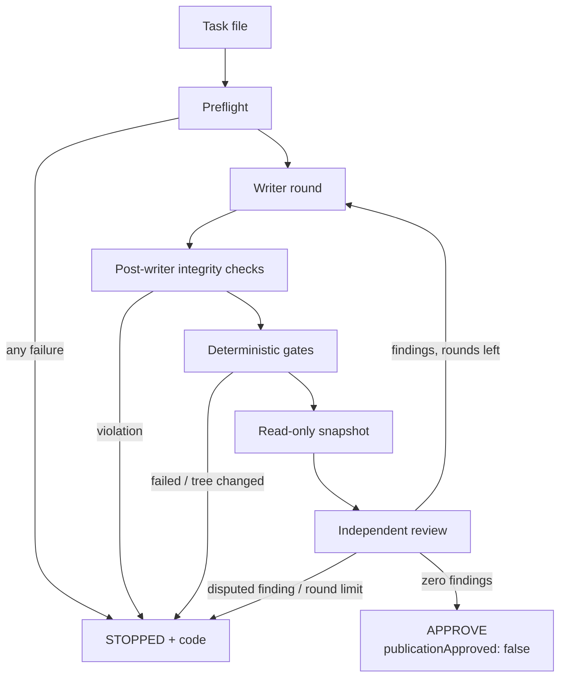

# Architecture

This document describes the runner as implemented in `scripts/` today. Planned
changes are listed in [ROADMAP.md](../ROADMAP.md), not here.

## Components

| File | Role |
| --- | --- |
| `scripts/agent-review-loop.mjs` | CLI entry point. Parses arguments, imports the project profile, runs the loop, renders the terminal dashboard, sets the exit code. |
| `scripts/agent-review-loop-lib.mjs` | Runner core: task parsing, profile validation, process runner, guards, gates, snapshots, agent invocation, report. |
| `scripts/agent-review-prompts.mjs` | Prompt texts for the writer and the reviewer, in English (`locale: 'en'`, neutral about providers and projects) and Polish (`'pl'`). No imports; the core passes it the locale and validated values. Profiles cannot override prompts; they only choose the locale. |
| `scripts/agent-review-providers.mjs` | The default `implementer` and `reviewer` values and `PROVIDERS`, the built-in providers in the adapter shape of earlier versions (kept for compatibility). Imports only the modules below. |
| `scripts/providers/contract.mjs` | Provider contract (core): module shape, security declaration, role rules, forbidden arguments. See [providers.md](providers.md). |
| `scripts/providers/codex.mjs`, `scripts/providers/claude.mjs` | Built-in provider modules. Import only the contract; the core passes them validated values. |
| `scripts/providers/conformance.mjs` | Conformance suite for provider modules, run in tests without a CLI or model. |
| `scripts/agent-review-dashboard.mjs` | Argument parser and terminal presentation. Presentation never changes the report or the exit code. |
| `scripts/agent-review-profile.mjs` | The project profile (binding point). See [profile.md](profile.md). |
| `bin/ringi.mjs`, `scripts/ringi-cli.mjs` | The `ringi` command: `init`, `doctor` and `run`. `run` is the flow of `agent-review-loop.mjs` with the profile from `ringi.config.mjs` (`loadProjectProfile` in the core). See [cli.md](cli.md). |
| `scripts/ringi-init.mjs`, `scripts/ringi-doctor.mjs` | `ringi init` (profile and task templates, never overwrites) and `ringi doctor` (read-only checks with the core's preflight functions). |

`scripts/agent-review-loop.mjs` treats the parent directory of `scripts/` as
the repository it works on; the scripts are bound to a project by placing
them in that project's `scripts/` directory and replacing the profile
module. The `ringi` command instead works on the Git repository of the
current directory, with that repository's `ringi.config.mjs` (see
[cli.md](cli.md)). From version 0.1.0 the command is installed from the npm
package `ringi-gate`; it also runs from a checkout.

## Roles

The profile chooses the provider of each role (see
[docs/providers.md](providers.md)); the tools below are the built-in
providers, with the default profile setting marked. "The writer" below
means the implementer.

| Role | Tool | Access |
| --- | --- | --- |
| Implementer (writer) | Codex CLI (`codex exec`, default) or Claude Code CLI (`claude -p`, experimental, when the profile selects it) | Real working tree. Codex: sandbox `workspace-write` (implementation) or `read-only` (analysis), network access disabled, approvals disabled. Claude Code: see [Claude Code as implementer](#claude-code-as-implementer). `git`, `pnpm`, `corepack` and other package managers on its `PATH` are guard scripts (see below). |
| Gates | The runner itself | Runs the checks from the profile after the writer, with `shell: false`, outside the Codex sandbox and with the user's permissions. Only the environment is isolated: separate home, configuration, cache and temporary directories, an empty npm user configuration, global Git configuration disabled, Corepack network disabled. |
| Reviewer | Claude Code CLI (`claude -p`, default; the only built-in reviewer) | A read-only copy of the repository. Tools limited to `Read`, `Glob` and `Grep`; permission mode `dontAsk`; no session persistence; slash commands disabled. |
| Decision | A human | Every run report (`APPROVE` or `STOPPED`) has `publicationApproved: false`; the runner never sets it to `true`. |

Exactly one writer works per round, and the runner refuses to start a second
process while one is active (`CONCURRENT_PROCESS`). The first review does not
receive the writer's reasoning or self-assessment: the reviewer gets the task,
the repository instructions, the full diff and the runner's own gate report,
and is told not to present the writer's claims as runner results. Later
reviews also get the previous findings and the writer's formal responses.
The reviewer runs with an allowlisted set of environment variables.

### Roles and providers

The runner has two agent roles, `implementer` (the writer) and
`reviewer`, and provider modules that serve them: the built-in `codex` and
`claude` modules in `scripts/providers/`, and modules a profile passes in
`providerModules` (objects, never paths). Each module follows the provider
contract in [providers.md](providers.md): `id`, `program`, `versionArgs`,
`roles`, `efforts`, `isValidModel`, and per role the task modes, stability,
known limits, a security declaration for each safety guarantee, and the
functions that build argv and environment, read results and sessions and
(implementer) check the host. The core validates every module and refuses a
role whose declaration lacks the guarantees the role needs
(`PROVIDER_ROLE_NOT_ALLOWED`). The declaration is the module's self-report:
the core does not verify a CLI's sandbox, network blocking, approval prompts
or user configuration; review of the module does. Independently of it, the
core takes the argv as a frozen copy of plain strings and scans it for
known bypass patterns (a safety net, not a guarantee), requires the
environment to equal its own (`PROVIDER_CONTRACT_VIOLATION` before the
process), applies its session, model and task mode rules, and applies the
Git checks of the Claude Code writer (below) to every module from a
profile. `scripts/providers/conformance.mjs` checks a module without a CLI
or model.

| Provider | Roles | Efforts |
| --- | --- | --- |
| `codex` | `implementer` | `medium`, `high`, `xhigh`, `max` |
| `claude` | `implementer` (experimental), `reviewer` | `medium`, `high`, `xhigh` |

Modules only describe the process; the provider's own sandbox settings are
part of its argv (for `codex`: sandbox by task mode, network access and
approvals disabled; for `claude` as reviewer: read-only tools, `dontAsk`, no
session persistence; for `claude` as implementer: see below). The core keeps
everything else that makes a run fail-closed,
for every provider: validation and stop codes, the isolated writer
environment without credentials and with Corepack network disabled, the
reviewer's allowlisted environment, the guards, the output schemas and
report validation, the snapshot and all integrity checks.

The profile's `implementer` and `reviewer` sections (see
[profile.md](profile.md#implementer)) choose the provider, model, effort
and review profiles; without them the core defaults apply. CLI options
`--codex-model`, `--sol-effort` and `--review-profile` override these values
within the profile's allowlists. In the default `reviewer`, the review
profile `critical` (default) has two attempts and may fall back to the
second model only for model unavailability, capacity or usage limit errors;
other profiles have a single attempt.

### Claude Code as implementer

**Experimental, not for untrusted tasks** (see the known limits at the end
of this section). A profile may select `implementer.provider: 'claude'`.
The adapter keeps the
guarantees of the `codex` writer with Claude Code CLI mechanisms, checked
against the help of Claude Code 2.1.285 and by probes of the real 2.1.285
CLI with the adapter's flags (results in the worker's report of the task):
with and without `--safe-mode`, a sandboxed `curl` to an outside host was
denied by the sandbox's network rules, and `touch` outside the working
directory (and in the user's home) failed with "Operation not permitted".

| Guarantee of the `codex` writer | `claude` writer |
| --- | --- |
| No approval prompts (`-a never`) | `--permission-mode dontAsk` (analysis) or `acceptEdits` (implementation) with `--permission-prompts none`: anything that would prompt is denied. Never `--dangerously-skip-permissions` or `bypassPermissions`. |
| Sandbox by task mode | analysis: `--tools Read,Glob,Grep` (no edit or command tool). implementation: `--tools Read,Glob,Grep,Edit,Write,Bash`. File tools: `--restricted` confines them to the working directory (the repository root), and their writes to settings, Git and tool-configuration files are left to a person, so they are denied. Bash: any command is auto-allowed inside the sandbox (`autoAllowBashIfSandboxed`), which limits writes to the working directory **including `.git`** and the paths the sandbox itself allows, such as temporary directories; the core therefore checks the Git directory after every round (below). No `--add-dir` and no `--allowedTools`. |
| No network for commands (`network_access=false`) | `--settings` with `sandbox.enabled: true`, `sandbox.network.allowedDomains: []`, `sandbox.network.strictAllowlist: true` (hosts outside the empty list are denied without a prompt), `sandbox.allowUnsandboxedCommands: false` (no command runs outside the sandbox) and `sandbox.autoAllowBashIfSandboxed: true`. `--disallowedTools WebFetch,WebSearch`. |
| Unavailable sandbox stops the run | `sandbox.failIfUnavailable: true`: the CLI exits at startup instead of running commands unsandboxed; the runner stops with `PROCESS_FAILED` (stage `codex`). Preflight accepts only macOS and Linux and Claude Code versions from 2.1.285 up to, but not including, 2.2.0, without a pre-release or build suffix (`IMPLEMENTER_PREFLIGHT_FAILED`); see the limits below. |
| No user configuration (`--ignore-user-config --strict-config`) | `--safe-mode` (CLAUDE.md, skills, plugins, hooks, MCP servers, custom commands and agents disabled), `--restricted` (user, project and local settings files ignored), `--strict-mcp-config` (no MCP server without `--mcp-config`, which is not passed), `--disable-slash-commands`. |
| Guards first on `PATH` | The same `processEnvironment` as `codex`: guard directory first on `PATH`. |
| Isolated environment without credentials | The same isolated offline environment as `codex`: no key or token in the environment, and `CLAUDE_CONFIG_DIR` is removed as for `codex` (the CLI uses its default configuration directory and stored login). This covers environment variables only: commands can read files under the user's home, as with `codex`. |
| Git state | `codex`: the `workspace-write` sandbox keeps `.git` read-only as documented by Codex; not checked by this runner (no change from earlier versions). `claude`: preflight refuses repository layouts outside the fingerprint; the CLI's process group and the groups the process watch saw are killed when it exits (best effort; a survivor or an unreadable process table is `IMPLEMENTER_PROCESS_SURVIVED`, and a background Bash command that escaped between two readings outlives it, see the known limits); the Git directory fingerprint is compared around every round, and a change is `UNEXPECTED_GIT_MUTATION` (stage `post-codex`) before any gate, and again after the gates and after the review; the core's own Git commands use a private index built from `HEAD` (below). |
| Output matches the schema (`--output-schema`, `-o`) | `--output-format json` and `--json-schema` with the same writer schema. Only a result envelope with `type: 'result'` and `is_error: false` counts; `structured_output` or a JSON text `result` then goes through the same report validation. Anything else is `INVALID_AGENT_OUTPUT`. |
| Correction rounds resume the session (`exec resume <id>`) | `--resume <id>` with the session ID read from the previous envelope (`session_id`, a UUID). A missing or malformed ID, or a resumed round that reports another ID, is `INVALID_AGENT_OUTPUT`. |
| Analysis sentinel and artifact | Unchanged core checks. |

The reviewer always runs as before: a new process on the read-only copy with
`--no-session-persistence`, without any session ID of the writer. With the
same provider in both roles the report's `reviewer` field carries
`warnings: ['SAME_PROVIDER_REVIEW']`.

Checks the core adds around every round of the Claude Code writer (declared
by the module as `gitDirectoryWritable` and `scratchDirectories`) and of any
writer module from a profile's `providerModules`, whatever it declares; the
`codex` writer runs as before:

- **Repository layout (preflight).** Before any process of the Claude Code
  CLI (also before `claude --version`) the run stops with
  `IMPLEMENTER_PREFLIGHT_FAILED` when `.git` in the repository root is not
  a directory (a linked worktree or a submodule, whose `.git` file is in
  the writable working tree), when the Git directory is not that `.git`,
  when `.gitmodules` exists, when the Git directory has entries in
  `modules/` (submodule repositories) or `worktrees/` (linked worktrees),
  or when `objects/info/alternates` exists (objects outside the
  fingerprinted directory), and when an entry the fingerprint reads as a
  plain file or directory is a symbolic link: `config`, `packed-refs`,
  `shallow`, `HEAD`, `config.worktree`, `commondir`, `index`, `refs`,
  `logs`, or anything at or below `objects/`, `info/` and `hooks/` (a link
  would be hashed by its target path, and a change behind it would go
  unseen). These layouts are outside the fingerprint below. `codex` runs as
  before in all of them.
- **Process group and process watch (best effort).** The CLI is spawned in
  its own process group and session; when it exits, the core kills that
  group (`SIGKILL`) before any check. Claude Code's Bash runs each command
  in a new session and process group of its own, and a command such as
  `nohup sleep 300 &` leaves a process that is orphaned at once (parent
  1) and outlives the CLI (probe of 2.1.285; the session ID cannot be read
  on macOS, where `ps -o sess` prints 0). So, while the CLI runs, the
  default process runner (`createProcessRunner`) reads the process table
  (`/bin/ps` or `/usr/bin/ps` only, never `ps` from `PATH`;
  `ps -A -o pid=,ppid=,pgid=,stat=,lstart=`, zombies left out) every
  200 ms. A process is identified by its PID and start time (`lstart`,
  compared as text), so a PID the system reuses for another process is not
  taken for a recorded one. Each reading drops the recorded processes that
  are gone (PID absent); a recorded PID present with another start time
  (a reused PID, or a clock step that shifts `lstart` on Linux, cannot be
  told apart) kills nothing and rejects the round as below. Then the
  reading records the CLI, the
  children of recorded processes and the members of the groups kept from
  the previous reading, and keeps only the groups that still have a
  recorded member; a recorded process that moved to another group (for
  example with `setsid`) stays recorded and brings its new group. A group
  whose leader (PID equal to the group ID) is present but not recorded is
  taken for a reused number and records nothing. The runner's own process
  group and its `ps` processes are never recorded. When the CLI exits the
  core kills every recorded process still present by PID (`SIGKILL`),
  whatever its group, and a recorded group only when its leader and all
  its present members are recorded; then it reads the table again until
  none is left. A recorded process still present after 2 seconds, a
  recorded PID present with another start time, or a table that cannot be
  read or processed at any point (no `ps` at those
  paths, an error or timeout of `ps`, unexpected output or a line without
  a start time, Windows), rejects the round with
  `IMPLEMENTER_PROCESS_SURVIVED` (stage `codex`); the post-round checks
  still run and are added as integrity violations. A process is found
  only if a reading sees it, or its parent or group, while that is still
  in the CLI's tree or a recorded group: the window is the interval plus
  the time `ps` takes. The probe's case (a wrapper shell that starts
  `nohup … &` and ends) is covered only when a reading falls within the
  wrapper's life; a process that left the tree and the recorded groups
  between two readings is not found (see the known limits below). The
  watch does not look at working directories or environments. It runs only for
  writers with the Git directory checks (not for `codex`), and only in the
  default process runner; a runner passed in by a caller has to provide
  its own. Tested on macOS; on Linux it uses the same `ps` options
  (procps) and has not been tested on a Linux host.
- **Git directory fingerprint.** Probes showed that Bash inside the Claude
  Code sandbox can write in `.git` (for example `touch .git/probe-file`).
  Before the round and after it the core reads one SHA-256 per part: `refs`
  (`git for-each-ref` names, values and symbolic targets, including
  `refs/replace/`), `indexEntries` (`git ls-files -s`: mode, object ID,
  stage and path of every index entry), `indexFlags` (`git ls-files -v`
  entries other than `H`, i.e. skip-worktree, assume-unchanged and other
  index states), `files` (`config`, `packed-refs`, `shallow`,
  `objects/info/alternates` of the common Git directory, and `HEAD`,
  `config.worktree`, `commondir` of the worktree's), `info` (including
  `info/grafts`) and `hooks` (every entry with type, mode and content,
  symbolic links by target) and `entries` (top-level names of the Git
  directories). The index commands read the repository's own index.
  `objects` covers every entry under `objects/` by metadata, without
  reading contents: files (loose objects, `objects/pack/*`,
  `objects/info/**` such as `commit-graph`) by type, mode, size, inode,
  change and modification time, directories by type, mode and inode. An
  entry present before the round must be unchanged; a new entry is allowed
  only as a valid new loose object (its inflated content hashes to its
  name), which cannot change what an existing object ID resolves to. Any
  other change (a new or rewritten pack, a new `commit-graph`, a rewritten,
  removed or freshened loose object, an invalid loose object) is a change
  of `objects`; so is any Git command of the round that writes an object
  already present.
  Any changed part stops the run with `UNEXPECTED_GIT_MUTATION` (stage
  `post-codex`; the message names the parts) before the gates, the
  snapshot and the review. After the round the file parts and `objects`
  are read first, without Git, from the directories resolved before the
  round; when one of them changed, the run stops at once, so a
  configuration, attributes file, hook or object written to `.git` is not
  used by any later Git command of the runner. When the round itself
  fails, the change is added to the stop as an integrity violation. Not
  compared: object contents (they are not read; see the private index
  below), reflogs and the index file's own bytes and stat data
  (read-only `git status` rewrites them). A Git directory over 4,096
  entries or 16 MiB in the content parts, or over 262,144 entries under
  `objects/`, stops with `INTEGRITY_CHECK_FAILED`; new loose objects over
  64 MiB in total are not verified and count as a change of `objects`.
- **Private index for the core's Git commands.** From the preflight on
  (right after the staged-changes check) every Git command of the core that
  is not part of the fingerprint (diffs and changed-path lists for the
  reviewer and the gates, the secret scan, manifests, snapshots, `HEAD`
  versions of files) runs with `GIT_INDEX_FILE` set to a private index in
  a new directory under the system temporary directory and with
  `GIT_NO_REPLACE_OBJECTS=1`. The index is built with `git read-tree HEAD`
  and refreshed against the working tree (`git update-index -q --refresh`)
  in the preflight and again after every round, once the fingerprint has
  passed, in a new directory each time (the sandbox can write in temporary
  directories, so an index left from before the round is never reused);
  the directories are removed when the run ends. Without a private index
  (removed, or its rebuild failed) a Git command of the core that passes
  no environment of its own stops with `INTEGRITY_CHECK_FAILED`; it never
  falls back to the repository index. What the reviewer and the
  gates see therefore depends on `HEAD` and the working tree only, not on
  the repository index (skip-worktree, assume-unchanged, intent-to-add or
  different object IDs there) and not on replace refs. It still depends
  on the objects `HEAD` names; those are covered by `objects` above.
  Commands run by the gates themselves (project checks) are not changed.
- **Scratch directory `.claude/.cc-writes`.** Claude Code creates this empty
  directory in the working directory when Bash runs. Before the round it
  must be missing or an empty directory reached without symbolic links;
  after the round it must again be missing or empty. An empty one the
  round created is removed, together with `.claude` when the round created
  it and it is empty; an empty one that existed before the round is kept.
  A file inside, a symbolic link or a
  file in its place stops the run with `IMPLEMENTER_SCRATCH_NOT_EMPTY`
  (stage `codex` before the round, `post-codex` after it): when Git ignores
  `.claude/`, such files would not be seen by the working-tree checks.
- **Permission denials.** The `permission_denials` of the result envelope
  (tool calls the CLI denied) are stored in the round's `solExecution` as
  `permissionDenials: { count, entries: [{ toolName, toolInput }] }`, at
  most 20 entries, `toolInput` as redacted JSON of at most 500 characters;
  `null` when the envelope has none.
- **Checks after the gates and after the review.** The CLI has
  exited, but a process it left behind could still write. After the gates
  (in analysis mode after the integrity checks), before the reviewer's
  snapshot or the report of a run without review, and again after the
  review, before the final report or the next round, the core compares the
  Git directory with the fingerprint taken before the round (all parts
  above) and the private index with a new one built from `HEAD` (entries
  and flags, `git ls-files -s` and `-v`); the index in use is kept. A
  difference stops the run with `UNEXPECTED_GIT_MUTATION` (stage
  `post-checks`, `analysis` or `post-review`; the message names the parts,
  `privateIndex` for the private index). The project profile
  (`ringi.config.mjs` and its import graph) is compared at the same points
  and stays the primary stop code (`PROFILE_MODIFIED`); its check after the
  review applies to every writer, including `codex` (it only reads the
  profile files). When a gate or the reviewer fails, the same Git
  directory and private index comparison (stage `post-checks` or
  `post-review`) is added to the stop report as an integrity violation,
  as after a failed round (`post-codex`).

Limits that the CLI does not let the runner close (known limits):

- A background process started by Claude Code's Bash that the process
  watch did not see (it left the CLI's process tree and the recorded
  groups between two readings, that is within the interval plus the time
  `ps` takes, or started a new session before any reading saw it) is not
  killed and outlives the CLI. It can change `.git`, the working tree or
  the private index. Such a change is detected only by the comparisons
  after the round, after the gates and after the review; a change after
  the last of them (after the final report), and any change to files
  ignored by Git, is not detected.
- Process identity rests on the start time `ps` prints (`lstart`, to the
  second). A PID reused within the same second, or a group whose number is
  freed and reused by a new leader that exits again within one interval,
  could still be taken for a recorded one; a reused PID can also be killed
  in the few milliseconds between a reading and the `SIGKILL`. A recorded
  PID whose start time changed between two readings is never dropped
  silently: a reused PID and a shifted `lstart` (on Linux procps derives it
  from the boot time, so a clock step during the round, for example by
  NTP or a VM time resync, shifts it for every process) cannot be told
  apart, so the round is rejected (`IMPLEMENTER_PROCESS_SURVIVED`) and a
  clock step costs a STOP, never a clean result.

- The sandbox write rules of Claude Code 2.1.285 could not be confirmed to
  have a key that keeps `.git` read-only for Bash: the help does not
  describe the sandbox settings, and the settings schema of 2.1.285 was not
  available to check. The core's fingerprint above detects the change after
  the round instead of preventing it, and does not undo it: after
  `UNEXPECTED_GIT_MUTATION` a person must inspect `.git` (for example
  `git config --local --list`, `.git/hooks`, `.git/info`,
  `git ls-files -s -v`, `git fsck`) before running Git in the repository
  again. Commands of the round itself could also use what they wrote to
  `.git` within the same round, inside the sandbox. The fingerprint and
  the private index cover the core's view of the repository; Git commands
  a person runs later use the repository index and configuration as the
  round left them when the run did not stop.
- Admin-managed (policy) settings of Claude Code still apply (`--safe-mode`
  and `--restricted` keep them), as Codex system configuration does for
  `codex`. They could, for example, widen the sandbox's allowed domains.
- In print mode Claude Code ignores settings that fail validation without an
  error. The probes confirmed that 2.1.285 applies the sandbox settings,
  also under `--safe-mode`; another version could rename a key and turn the
  sandbox off without a signal. Preflight therefore accepts only versions
  from 2.1.285 up to, but not including, 2.2.0; widening the range is a
  deliberate change after new probes. If the sandbox settings were ignored,
  the sandbox would be off and Bash would no longer be auto-allowed:
  commands that would prompt are denied by `--permission-prompts none`, but
  commands that Claude Code itself treats as read-only, or as file-system
  commands accepted in `acceptEdits`, could then run unsandboxed.
- There is no model-free command that reports whether the sandbox can start;
  the fail-closed check is `failIfUnavailable` at CLI startup.
- Commands joined with `;` (for example `make; echo $?`) are not
  auto-allowed: the CLI asks for approval, which `--permission-prompts none`
  denies. This is fail-closed but limits what the writer can run; such
  denials appear in `permissionDenials`.
- The sandbox also allows writes to temporary directories, and the
  environment passes `TMPDIR`; a repository located under a temporary
  directory therefore lets commands write next to it.
- Without `CLAUDE_CONFIG_DIR` the writer uses the CLI's default
  configuration directory and login. With a custom `CLAUDE_CONFIG_DIR` (kept
  for the reviewer) the writer may fail with `PROCESS_FAILED` for lack of a
  login, or run under another account.
- The CLI process itself stores the session under the user's Claude Code
  directory so that it can be resumed, and it reaches the model API; the
  same holds for `codex`.
- `--safe-mode` also skips the repository's `CLAUDE.md`; the writer prompt
  is the same as for `codex` and names the writer by its historical names.
- In analysis mode the Claude Code writer has no command tool at all, which
  is stricter than the read-only command sandbox of `codex`.

## Phases (implementation mode)

1. **Preflight.** Validates the profile and options, checks that the command
   runs in the expected Git repository, that the current branch is not `main`
   or `master` and HEAD is not detached, that nothing is staged, and loads and
   validates the task file. It records a secret-scan baseline and fingerprints
   of dependency inputs and installed dependency metadata, checks
   `codex --version` (and `claude --version` when review is required), reads
   `AGENTS.md` and `CLAUDE.md` from the repository root, and prepares isolated
   Corepack caches with network disabled for the pinned pnpm version
   (`packageManager` in `package.json` must be `pnpm@<exact version>`).
2. **Writer round.** The writer receives the task (round 1) or the open
   findings (later rounds) and must return a structured JSON report, which is
   validated against a schema.
3. **Post-writer integrity checks.** Branch and HEAD unchanged, nothing staged,
   dependency inputs and installed dependency metadata unchanged, no new
   secret-like content, required gate rules satisfied.
4. **Gates.** The runner executes every effective check of the task, one by
   one. Each gate must exit with code 0 within its timeout, and the
   repository manifest (see [Fingerprints and hashes](#fingerprints-and-hashes)),
   Git state, dependency state and Corepack cache must be identical before
   and after.
5. **Snapshot.** The files of the repository manifest are copied into
   a temporary directory, together with the full diff against HEAD, the
   trusted gate report and the repository instructions. The copy is made
   read-only and hashed; the working tree must not change while it is taken.
6. **Independent review.** The reviewer returns a structured verdict with
   findings (`BLOCKER`, `HIGH`, `MEDIUM`, `LOW`). The runner computes the
   result itself: any finding of any severity means another writer round.
   The snapshot and the working tree must be unchanged before and after each
   review attempt.
7. **Result.** With zero findings the run ends with `APPROVE`. Otherwise the
   writer gets the findings and must answer each one with `CONFIRMED`,
   `REJECTED` or `NEEDS_HUMAN`. The loop runs at most 3 rounds.

The runner never commits, pushes, merges or reverts. When it stops, the
writer's changes stay in the working tree for a human to inspect.

## Task modes and classes

- `--task-mode implementation` (default): the flow above.
- `--task-mode analysis`: the writer runs in a read-only sandbox and returns a
  full Markdown analysis, which the runner stores as a separate artifact with a
  SHA-256 hash. Instead of command gates the runner applies internal integrity
  checks; any write to the working tree stops the run
  (`ANALYSIS_WORKING_TREE_WRITE`). The reviewer receives a minimal read-only
  package (task, manifest, artifact, the exact files listed in the task) and
  must confirm, with hashes, that it read all of them.

The optional task class changes the flow in implementation mode. Classes
come from the profile's `taskClasses` (see
[profile.md](profile.md#taskclasses)); the default classes are
`implementation` (used when the task names no class), `critical`,
`docs-minor`, `docs-descriptive` and `docs-contract`. With the defaults:

- `docs-*` classes use the profile's `docs` check set instead of `base`, and
  the candidate must pass the profile's `docsCandidatePolicy`: by default it
  may only touch `README.md` and Markdown files under `docs/`; otherwise the
  run stops with `DOCS_CANDIDATE_REJECTED`. Within `docs/` the default rule
  also rejects path segments named `AGENTS.md`, `CLAUDE.md`, `SECURITY.md` or
  `SKILL.md` (case-insensitive), agent instruction files under
  `docs/development/` (`agent-*` and `frontend-agent-skills.md`), segments
  `.git`, `.agents`, `.claude`, `.codex` or `skills`. Whatever the profile
  says, the core rejects `AGENTS.md`, `CLAUDE.md`, `.git`, `.agents`,
  `.claude`, `.codex` and `skills`, and anything that is not a regular,
  non-executable file (in HEAD and on disk) or is reached through a symlink.
- For `docs-minor` and `docs-descriptive`, independent review is skipped and
  recorded as `NOT_REQUIRED`; the run ends with `APPROVE` after the gates. All
  other classes require independent review.

In any profile, a class may skip independent review only if it is limited to
the docs candidate rule (`docsOnly`), and `implementation` is always the full
track. Analysis mode accepts only `implementation` and always requires the
review.

## Task file

A task is a Markdown file inside the repository (not a symlink, at most
256 KiB). Sections are level 2–6 headings, matched case-insensitively with
runs of whitespace collapsed. The section names come from the profile's
`taskSchema` (see [profile.md](profile.md#taskschema)). The default schema
depends on the profile's `locale`: with `'en'` (the default) the English
names below are canonical and the Polish names are aliases of the same
sections; with `'pl'` it is the reverse.

| English name | Polish name | Required |
| --- | --- | --- |
| `Goal` | `Cel` | yes, non-empty |
| `Scope` | `Zakres` | yes, non-empty |
| `Acceptance criteria` | `Kryteria akceptacji` | yes, non-empty |
| `Required checks` | `Wymagane kontrole` | yes, non-empty |
| `Constraints` | `Ograniczenia` | yes, non-empty |
| `Deferred items` (alias `Deferred`) | `Elementy odłożone` | yes, non-empty |
| `Task class` | `Klasa zadania` | optional, at most once, level 2 (`##`) only |
| `Starting files` | `Pliki startowe` | optional |
| `Allowed change area` | `Dozwolony obszar zmian` | optional |
| `Review files` | `Pliki review` | required in analysis mode |

A heading written under an alias is stored under its canonical name, so a
task with English headings gives the same parse result as one with Polish
headings. A section that appears under an alias may not appear again under
its canonical name or another alias (`INVALID_TASK`). Other headings are
ignored and only end the previous section; a canonical heading repeated
without an alias keeps the last content, except the task class
(`INVALID_TASK_CLASS`). Only a level-2 heading sets the task class:
`### Task class` or `### Klasa zadania` (or any deeper level) stops the run
with `INVALID_TASK_CLASS` instead (or with `INVALID_TASK` under the alias
rule above, when the task also has a class section).

In implementation mode every backticked string in `Required checks` must be
the exact name of a check in the profile; anything else stops the run with
`UNSUPPORTED_CHECK`, and the text is never executed as a shell command. The
effective checks are the profile check set (`base` or `docs`) followed by the
requested checks, without duplicates. In analysis mode `Review files` must be
a list of 1–32 exact repository-relative paths in backticks. The core finds
these two sections and the task class through the schema, under their English
or Polish name.

The writer and reviewer prompts quote section names in the language of the
profile's `locale`: `"Starting files"`, `"Allowed change area"`, `"Required
checks"` and `"Review files"` with `'en'`, the Polish names with `'pl'`.
They do not quote the task's own headings; a task written with the other
language's names (aliases) or with a profile's own schema still parses, and
the prompt refers to the sections by the names of the default schema of the
locale.

The task file is also scanned for secret-like content (`SECRET_DETECTED`). See
[examples/task-add-health-endpoint.md](../examples/task-add-health-endpoint.md).

## Guards

During the writer round, `PATH` starts with a directory of guard scripts:

- `git`: only an allowlist of read-only subcommand names (`status`, `diff`,
  `log`, `show`, `grep`, `ls-files`, `rev-parse` and similar) is passed to the
  real Git; any other first argument exits with status 126. Options are not
  filtered: the guard checks only the subcommand name. (The stricter
  `git diff --check` option allowlist applies to gate checks in the profile,
  not to this guard.)
- `pnpm`: only `--version`/`-v` and the exact argv of the task's pnpm checks
  (plus their `nestedInvocations` from the profile) are passed through, always
  executed as `pnpm [--filter <package>] run <script>`.
- `corepack`: only `--version`.
- `npm`, `npx`, `yarn`, `yarnpkg`, `bun`, `bunx`: only `--version`/`-v`.

## Fingerprints and hashes

- Task: SHA-256 of the task file, recorded in the report.
- Repository manifest: SHA-256 over path, type, size, content hash and
  executable bit of every tracked and untracked, non-ignored file, excluding
  any path with a segment `node_modules`, `.pnpm-store`, `.next`, `dist`,
  `coverage`, `.turbo`, `.cache`, `tmp`, `playwright-report`, `test-results`
  or `.agent-review-loop` (tracked files there are excluded too); used to
  detect changes during gates and snapshots. Changes to ignored files and to
  these excluded paths are not detected.
- Snapshot: content hash of the read-only copy, plus a hash of the diff.
- Dependencies: fingerprints of dependency input files (`package.json`,
  lockfiles, workspace and package manager configuration) and of installed
  pnpm metadata in `node_modules`.
- Secrets: findings are identified by a hash of label and match. In
  preflight, secret-like content in uncommitted files that is not already in
  HEAD stops the run; later checks stop only on findings that are new
  compared with the preflight baseline.

## Report

After the preflight validation, a run (other than `--dry-run`) creates its
run directory and writes
`.agent-review-loop/runs/<runId>/report.json` with `schemaVersion: 1`,
per-round JSON files and bounded, redacted diagnostic logs. Once the profile
is valid, the report and the dry-run plan also carry `taskSchemaVersion`, the
`version` of the profile's task schema. `status` is
`APPROVE` or `STOPPED`; a stopped run also has `code`, `stage` and `error`.
The roles appear under the neutral fields `implementer` and `reviewer`
(provider, model, effort, review profile, attempt count) in the report, in
`agents` and in the `metadata` event; the earlier provider-specific fields
(`sol`, `agents.codex*`, `agents.claude*`, `findings.rejectedByCodex`) stay
as aliases with equal values. In each round, `implementer` and `reviewer`
only name the keys that hold the agent outputs (`rounds[].codex`,
`rounds[].claude`), so the outputs are not stored twice. The aliases name
the role, not the provider: with Claude Code as implementer, `sol` and
`codex*` describe the Claude Code writer. The full list is in
[profile.md](profile.md#report-fields).
`--dry-run` performs the preflight and prints a plan with status `DRY_RUN_OK`
without starting agents; this plan has no `publicationApproved` field.
`--json` prints the final report to stdout.

Exit codes of the CLI: `0` for a completed run, `1` for any stopped run,
including `UNEXPECTED_ERROR`, `2` for invalid arguments or an error outside
the runner.

## STOP codes

Codes are stable identifiers in the report and do not depend on the
language. Messages are in English, or in Polish with `locale: 'pl'` in the
profile (see [profile.md](profile.md#locale)). A selection, grouped by stage:

| Stage | Codes |
| --- | --- |
| Options and profile | `INVALID_CONFIGURATION`, `INVALID_TASK_MODE`, `INVALID_REVIEW_PROFILE`, `INVALID_CODEX_MODEL`, `INVALID_SOL_EFFORT`, `PROVIDER_ROLE_NOT_ALLOWED`, `RUNNER_MODIFIED` (a module of the runner's import graph changed during the run or cannot be read; the primary code; see [cli.md](cli.md)), `PROFILE_MODIFIED` (`ringi.config.mjs` or a module it imports changed during the run; see [profile.md](profile.md#protection-of-ringiconfigmjs)), `PROFILE_UNCOMMITTED` (`ringi run` only: `ringi.config.mjs` or a module it imports is not committed or differs from `HEAD`; a stop before the run) |
| Repository | `WRONG_REPOSITORY`, `PROTECTED_BRANCH`, `DETACHED_HEAD`, `STAGED_CHANGES`, `UNEXPECTED_GIT_MUTATION` |
| Task | `INVALID_TASK`, `INVALID_TASK_CLASS`, `INVALID_TASK_PATH`, `TASK_PATH_ESCAPE`, `UNSUPPORTED_CHECK`, `INVALID_ANALYSIS_REVIEW_FILES` |
| Environment | `MISSING_EXECUTABLE`, `INVALID_PACKAGE_MANAGER`, `PNPM_CACHE_MISSING`, `PNPM_VERSION_MISMATCH`, `DEPENDENCY_STATE_STALE`, `DEPENDENCY_MANIFEST_MISMATCH`, `IMPLEMENTER_PREFLIGHT_FAILED` |
| Integrity | `SECRET_DETECTED`, `DEPENDENCY_INPUT_CHANGED`, `DEPENDENCY_METADATA_CHANGED`, `COREPACK_CACHE_CHANGED`, `WORKING_TREE_CHANGED`, `SNAPSHOT_CHANGED`, `PATH_ESCAPE`, `SYMLINK_ESCAPE`, `SNAPSHOT_TOO_LARGE`, `DOCS_CANDIDATE_REJECTED`, `ANALYSIS_WORKING_TREE_WRITE`, `IMPLEMENTER_SCRATCH_NOT_EMPTY`, `IMPLEMENTER_PROCESS_SURVIVED` |
| Gates | `CHECK_FAILED`, `TIMEOUT`, `INTERRUPTED` |
| Agents | `PROCESS_FAILED`, `INVALID_AGENT_OUTPUT`, `OUTPUT_LIMIT_EXCEEDED`, `CLAUDE_PROCESS_FAILED`, `CLAUDE_FALLBACK_FAILED`, `PROVIDER_CONTRACT_VIOLATION` |
| Decision | `HUMAN_DECISION_REQUIRED`, `FINDING_DISPUTE`, `MAX_ROUNDS` |
| Other | `CLEANUP_FAILED`, `UNEXPECTED_ERROR` |

Codes from the profile's `requiredGateRules` always end in `_GATE`; no core
code does, so the two namespaces cannot collide.
